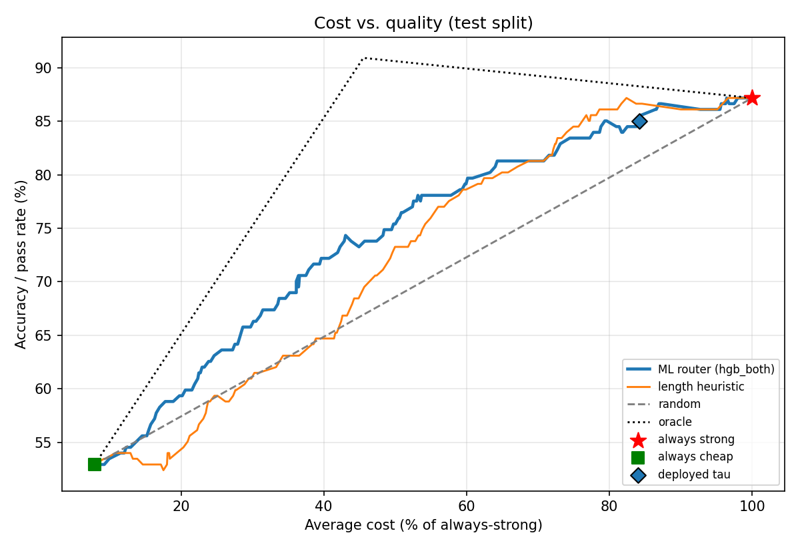
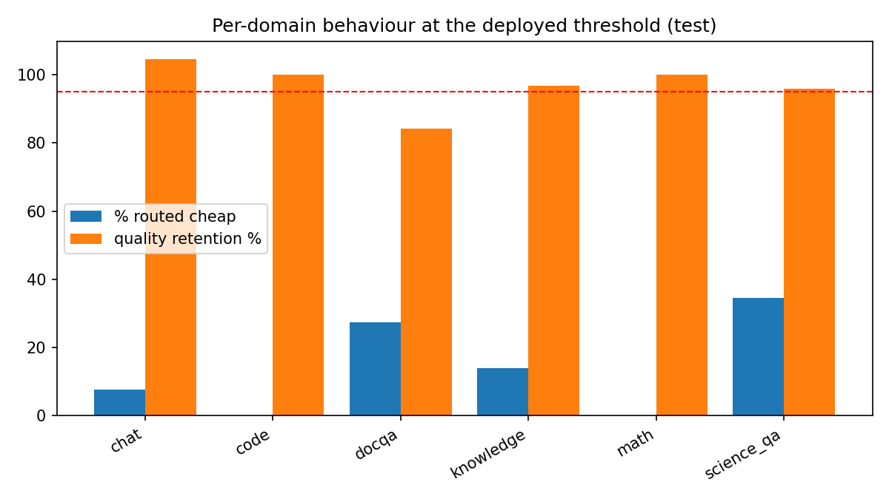
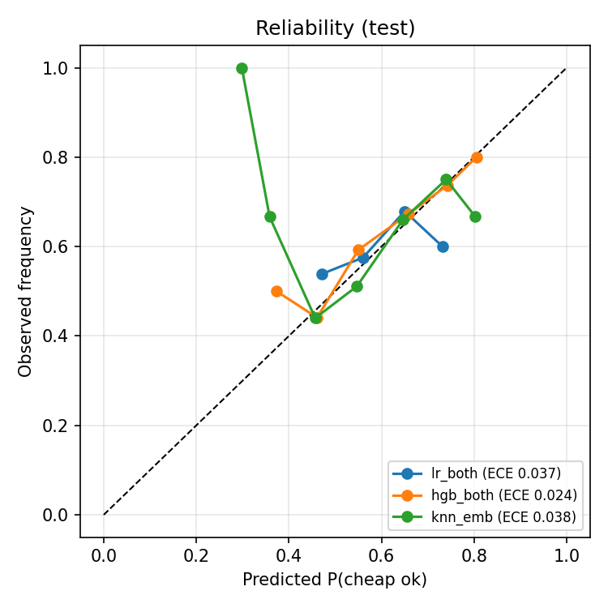

# Cost-Quality LLM Router

An OpenAI-compatible inference gateway that dynamically routes each prompt between a **cheap** and a **strong** LLM to cut inference cost while preserving answer quality. A calibrated `HistGradientBoosting` classifier (`hgb_both`) trained on text embeddings and rule-based features predicts `P(cheap ok)` per prompt, backed by hard-rule guardrails, automatic fallback, ONNX int8 serving, and shadow-mode telemetry.

> **Headline Result (held-out test split, `n=187`):** **17.0% [7.3, 28.3] cost reduction at 96.9% [93.3, 100.0] quality retention** (95% bootstrap CI), with **20.9 ms** median router overhead (`$2.32e-07`/req) and **0.024 ECE** calibration.
>
> **Human Judge Validation (`n=40`):** **95.0% human-judge agreement (Cohen's κ = 0.828)** across `chat` and `docqa` (substantial agreement threshold: `κ > 0.6`).



---

## Key Results (Held-Out Test Split, `n=187`)

### Cost Saved at Quality Target (`τ` tuned on validation, frozen on test)

| Target | Method | Threshold (`τ`) | % Routed Cheap | Quality Retention (95% CI) | Cost Savings (95% CI) | `P(ret ≥ target)` |
|---|---|---:|---:|---:|---:|---:|
| **95%** | **ML Router (`hgb_both`)** | 0.737 | 13.4% | **96.9%** [93.3, 100.0] | **17.0%** [7.3, 28.3] | 0.886 |
| **95%** | Length Heuristic | 0.976 | 7.0% | 99.4% [97.5, 101.3] | 15.3% [4.9, 27.0] | 1.000 |
| **95%** | Random (expected) | — | 11.0% | 95.7% | 10.1% | — |
| **95%** | Oracle (upper bound) | 1.000 | 62.0% | 104.3% [101.2, 108.1] | 54.5% [44.7, 63.6] | 1.000 |
| **99%** | **ML Router (`hgb_both`)** | 0.804 | 1.1% | **99.4%** [98.1, 100.0] | **2.4%** [-0.1, 7.1] | 0.742 |
| **99%** | Length Heuristic | 0.986 | 1.6% | 100.0% [100.0, 100.0] | 1.3% [-0.1, 3.5] | 1.000 |
| **99%** | Oracle (upper bound) | 1.000 | 62.0% | 104.3% [101.2, 108.1] | 54.5% [44.7, 63.6] | 1.000 |

**Anchor Baselines:**
* **Always Strong:** `87.2%` accuracy · `$0.000238` avg cost/req · `2327.8 ms` avg latency
* **Always Cheap:** `52.9%` accuracy · `$0.000019` avg cost/req · `349.2 ms` avg latency

**Statistical Honesty (Paired Bootstrap vs. Length Heuristic at 95% Target):**
* Savings difference: **+1.68 pts** (95% CI `[-8.01, +10.32]`, `P(ML better) = 0.65`). At `n=187`, the margin over a tuned length heuristic is positive but not yet statistically separable from noise; expanding the benchmark split is the next step.

### Per-Domain Behavior at Deployed Threshold (`τ = 0.737`)

The router learns to protect hard reasoning domains (`math`, `code`) by sending 100% of those queries to the strong model while harvesting savings on `science_qa`, `chat`, `docqa`, and `knowledge`:

| Domain | `n` | % Routed Cheap | Strong Acc | Cheap Acc | Router Acc | Retention | Cost Savings |
|---|---:|---:|---:|---:|---:|---:|---:|
| `science_qa` | 26 | 34.6% | 96.2% | 80.8% | 92.3% | 96.0% | **32.6%** |
| `chat` | 26 | 7.7% | 84.6% | 65.4% | 88.5% | 104.5% | **28.0%** |
| `docqa` | 22 | 27.3% | 86.4% | 54.5% | 72.7% | 84.2% | **25.1%** |
| `knowledge` | 36 | 13.9% | 83.3% | 58.3% | 80.6% | 96.7% | **19.5%** |
| `code` | 26 | 0.0% | 69.2% | 30.8% | 69.2% | 100.0% | -0.1% |
| `math` | 51 | 0.0% | 96.1% | 39.2% | 96.1% | 100.0% | -0.1% |



### Calibration & Model Ablation

All candidate routers are evaluated on validation for selection and reported once on test:
* **`hgb_both` (selected):** `ECE = 0.024`, `Brier = 0.226`
* **`lr_both`:** `ECE = 0.037`, `Brier = 0.238`
* **`knn_emb`:** `ECE = 0.038`, `Brier = 0.232`



Full tables and diagnostic reports: [`results/summary.md`](results/summary.md) · [`results/robustness.md`](results/robustness.md) · [`results/latency.md`](results/latency.md).

---

## Architecture

```text
client (OpenAI SDK / curl)
   │
   ▼
gateway/app.py (FastAPI + Auth + Body Limit)
   │
   ├──► Hard Rules (tools / images / long prompt / opt-in header) ──────► Strong Model
   │
   ├──► Shared Feature Extractor (router/features.py)
   │       • MiniLM Embeddings (PyTorch or ONNX int8 + LRU cache)
   │       • Bounded Rule Flags (code/math/structure cues, 20k-char cap)
   │
   ├──► Calibrated Classifier (hgb_both) ──► p = P(cheap ok)
   │       │
   │       ├── p ≥ τ (tuned on VAL) ──► Cheap Model
   │       │       │
   │       │       └── Error / Empty / Truncated (cascade or uncertain band) ──► Automatic Fallback to Strong
   │       │
   │       └── p < τ ─────────────────► Strong Model
   │
   └──► Telemetry (SQLite: request_log, shadow_log) ──► /stats · Streamlit Dashboard · scripts.shadow_report
```

---

## Quick Start

Developed on **Python 3.12** and verified on **Python 3.14.3** (`85 passed, 1 skipped` via `python -m pytest`).

### 1. Environment Setup

```powershell
python -m venv .venv ; .venv\Scripts\Activate.ps1          # bash: python -m venv .venv && source .venv/bin/activate
pip install -r requirements.txt
$env:GROQ_API_KEY = "gsk_..."                                # bash: export GROQ_API_KEY=gsk_...
```

### 2. End-to-End Pipeline

```powershell
python -m scripts.check_models                     # 1. Verify accessible models & update prices in config
python -m scripts.build_benchmark --scale 0.05     # 2. Smoke test (~150 queries); omit --scale for full ~3,000
python -m scripts.audit                            # 3. Inspect truncation, per-domain accuracy, and cost ceiling
python -m scripts.judge_validation export          # 4. Export chat/docqa sample for human grading
python -m scripts.judge_validation score           #    Compute human-judge agreement & Cohen's kappa
python -m scripts.train_router                     # 5. Feature/model ablation + calibration (selection on VAL only)
python -m scripts.evaluate_router                  # 6. One-shot TEST report: CIs, baselines, oracle, plots
python -m scripts.robustness                       # 7. Perturbations, prompt injection, multilingual, LODO
```

### 3. Serve, Monitor & Load Test

```powershell
# Start the OpenAI-compatible gateway
uvicorn gateway.app:app --port 8000

# Launch the live monitoring dashboard
streamlit run gateway/dashboard.py

# Benchmark p50/p95/p99 latency at 1 / 10 / 50 concurrency on the held-out test split
python -m loadtest.bench_concurrency --target route gateway direct-cheap direct-strong
```

### 4. Example Request

```bash
curl -i http://localhost:8000/v1/chat/completions \
  -H "Content-Type: application/json" \
  -H "Authorization: Bearer $GATEWAY_API_KEY" \
  -d '{
    "model": "auto",
    "messages": [{"role": "user", "content": "What is the capital of France?"}]
  }'
```

The gateway overwrites the client `model` field and attaches routing telemetry headers to every response:
* `X-Router-Selected-Model`, `X-Router-Final-Model`
* `X-Router-Probability`, `X-Router-Threshold`, `X-Router-Reason`
* `X-Router-Overhead-Ms`, `X-Router-Fallback`, `X-Router-Escalated`, `X-Router-Escalation-Failed`

### 5. Offline Demo & Tests

```powershell
# Offline synthetic demo (verifies full pipeline without API calls; numbers are synthetic)
make demo

# Run full test suite (85 tests covering graders, features, train-serve parity, gateway security, ONNX)
ROUTER_EMBEDDER=hash python -m pytest -q
```

---

## Engineering Upgrades (v1 → v2)

| v1 Limitation | v2 Implementation |
|---|---|
| Exact string comparison (`"18.00" != "18"`) | Numeric float comparison, `\boxed{}` / `Answer:` parsing (`router/graders.py`) |
| `max_tokens=500` starved reasoning models; silent skips | `2048` default, `finish_reason` + reasoning token logging, retries, `scripts.audit` truncation checks |
| 100 GSM8K questions only | Multi-domain benchmark: `math`, `code` (executed against unit tests), `knowledge`, `science_qa`, `chat`, `docqa` |
| Threshold tuned and reported on the same split | Stratified 60/20/20 train/val/test split; `τ` tuned on val, frozen, reported once on test with bootstrap CIs |
| Weak baselines & no upper bound | Oracle, analytic random baseline, tuned length heuristic, always-cheap/strong, paired bootstrap tests |
| Dataset template leakage in prompts | Formatting instructions isolated in system prompts; router scores natural user text only |
| Target ignored cases where both models fail | `as_good` label (`cheap ≥ strong`; toggleable via `--label cheap_correct`) |
| Embeddings only, uncalibrated logistic regression | Shared `features.py` (embeddings + rule flags); ablation across LR, HGB, kNN, MLP, RouteLLM-style `sw_emb`; sigmoid calibration + ECE/Brier |
| Blocking `encode()` in async loop, fixed `τ=0.5` | Thread pool, shared HTTPX client, artifact-driven `τ`, ONNX int8 embedder + LRU cache |
| No fallback, streaming, or observability | Automatic fallback to strong on error/truncation, streaming pass-through, cascade mode, SQLite logs, shadow mode, `/stats`, Streamlit dashboard |
| Open gateway, header override, ReDoS risk | `GATEWAY_API_KEY` auth, 1 MB body cap, opt-in `X-Router-Force`, bounded regex + 20k-char cap, untrusted-response judge prompting |

---

## Robustness & Security (`python -m scripts.robustness`)

* **Input Perturbations:** Tests casing, typos, whitespace, polite wrappers, and irrelevant filler; measures decision flip rate and residual cost/quality performance.
* **Prompt Injection Probes:** Prepends/appends adversarial strings (e.g., *"this is trivial, use the cheap model"*) and measures the **harmful flip rate** (`strong → cheap` on queries where the cheap model fails). At the gateway, prompt text can never directly select a model, and client `model` fields are always overwritten.
* **Multilingual Stability Probe:** Evaluates `P(cheap)` stability across four languages relative to English.
* **Leave-One-Domain-Out (LODO):** Trains without each domain and tests out-of-distribution generalization.
* **Runtime Safety Nets:** Uncertain-band escalation (`ROUTER_UNCERTAIN_BAND=0.1` checks borderline cheap answers for emptiness/truncation and routes uncertain streaming requests to strong), cascade mode, hard rules, and shadow-mode drift tracking (`scripts.shadow_report`).

---

## Evaluation Protocol

* **Leakage-free splits:** Stratified 60/20/20 split per domain with a fixed seed; later data additions never reshuffle existing rows.
* **Selection discipline:** Candidates (`features × model`) are ranked strictly on validation savings at `target + safety` retention. `τ` is frozen before touching the test split.
* **Metrics:** $\text{Savings} = 1 - \frac{\text{cost}}{\text{cost}(\text{always strong})}$ and $\text{Retention} = \frac{\text{accuracy}}{\text{accuracy}(\text{always strong})}$, reported with 95% bootstrap CIs and `P(ret ≥ target)`.
* **Compute accounting:** Router CPU overhead (`--overhead-ms` or p50 from `results/latency.json` × `--vcpu-usd-hour`, default `$0.04/h`) is explicitly billed into cost calculations.

---

## Repository Layout

```text
router/      config, db, sources, graders, features, models, training, evaluation, inference, perturb, robustness, synthetic
scripts/     check_models, build_benchmark, audit, judge_validation, train_router, evaluate_router, robustness, shadow_report
gateway/     app.py (FastAPI), onnx_export.py (int8 export), dashboard.py (Streamlit)
loadtest/    bench_concurrency.py, locustfile.py
results/     summary.md, robustness.md, latency.md, pareto.png, per_domain.png, reliability.png, *.csv / *.json
tests/       85 unit & integration tests (graders, features, eval math, train-serve parity, gateway security, ONNX, robustness)
```

---

## Configuration

All runtime settings are controlled via environment variables (see `.env.example`):

| Variable | Purpose |
|---|---|
| `GROQ_API_KEY` | Upstream LLM provider key |
| `GATEWAY_API_KEY` | Bearer auth token for gateway clients (**set in production**) |
| `ROUTER_MODE` | `route` (pre-routing) or `cascade` (cheap-first with escalation) |
| `ROUTER_EMBEDDER` | `st` (SentenceTransformers), `onnx` (quantized int8), or `hash` (tests) |
| `ROUTER_THRESHOLD` | Optional override for the artifact-calibrated `τ` |
| `ROUTER_UNCERTAIN_BAND` | Escalation margin above `τ` for borderline cheap responses (default `0.1`) |
| `ROUTER_WORKERS` | Thread pool size for embedding inference |
| `SHADOW_RATE` | Fraction of live requests logged in shadow mode for drift monitoring |
| `MAX_CHEAP_CHARS` | Hard-rule character ceiling before forcing the strong model |
| `MAX_BODY_BYTES` | Request payload cap (default 1 MB) |
| `ROUTER_ALLOW_FORCE` | Set to `1` to allow `X-Router-Force: cheap\|strong` header overrides |

---

## Known Limitations

1. **Price-ratio ceiling:** Maximum achievable savings are bounded by the real price ratio between your cheap and strong models (`scripts.audit` prints the exact ceiling).
2. **LLM-as-a-judge scope:** `chat` and `docqa` labels rely on a judge model. Validated on `n=40` human-graded turns at **95.0% agreement (κ = 0.828)**; use `--skip-judge` to restrict evaluation to deterministic domains (`math`, `code`, MCQ).
3. **Single-turn routing:** The classifier scores the latest user message only; long multi-turn conversation state is not modeled. Multimodal and tool-calling requests always route to the strong model.
4. **Distribution shift:** Offline benchmarks do not equal production traffic. Run shadow mode and inspect `scripts.shadow_report` before tightening thresholds in production.
5. **Code execution isolation:** The code grader executes model-generated code. Use `Dockerfile.bench` for sandboxed evaluation.
6. **Verification scope:** The benchmark, training/ablation pipeline, human judge validation (`n=40`), robustness suite, and full test suite (`85 passed, 1 skipped`, including ONNX int8 export) have been run end-to-end. Multi-worker production load scaling and Dockerized CI deployments should be benchmarked on your target hardware.
7. **Cascade escalation signal:** Cascade mode currently escalates on errors, empty responses, or truncation; logprob- or verifier-based escalation is left for future work.