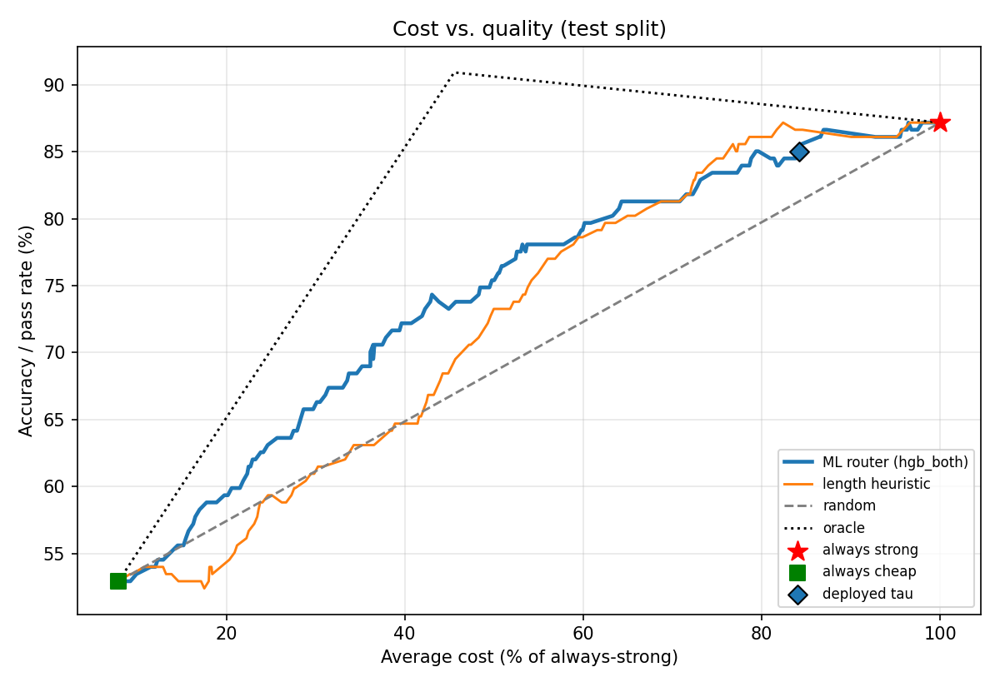
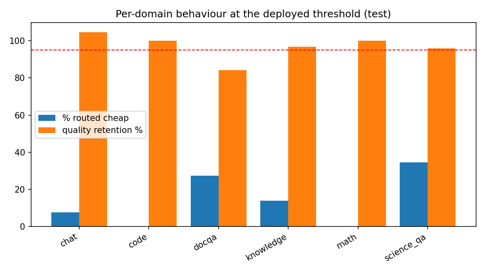
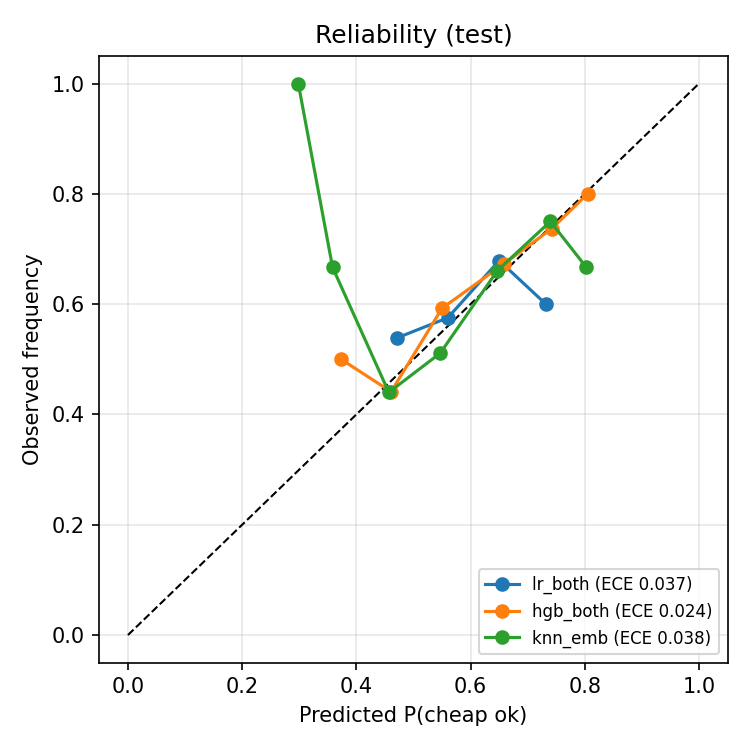

# Results (held-out test split, n=187)

**ML router (hgb_both): 17.0% [7.3, 28.3] cost reduction at 96.9% [93.3, 100.0] quality retention (95% bootstrap CI) on 187 held-out test queries.**

_Router overhead charged: 20.9 ms/request = $2.32e-07/request (vCPU at $0.04/h)._

## Cost saved at a quality target (tau tuned on val, frozen on test)

| target | method | tau | pct_cheap | retention | savings | P(ret>=target) |
|---|---|---|---|---|---|---|
| 95% | ML router (hgb_both) | 0.737 | 0.134 | 96.9% [93.3, 100.0] | 17.0% [7.3, 28.3] | 0.886 |
| 95% | length heuristic | 0.976 | 0.070 | 99.4% [97.5, 101.3] | 15.3% [4.9, 27.0] | 1.000 |
| 95% | oracle | 1.000 | 0.620 | 104.3% [101.2, 108.1] | 54.5% [44.7, 63.6] | 1.000 |
| 95% | random (expected) | nan | 0.110 | 95.7% | 10.1% | nan |
| 99% | ML router (hgb_both) | 0.804 | 0.011 | 99.4% [98.1, 100.0] | 2.4% [-0.1, 7.1] | 0.742 |
| 99% | length heuristic | 0.986 | 0.016 | 100.0% [100.0, 100.0] | 1.3% [-0.1, 3.5] | 1.000 |
| 99% | oracle | 1.000 | 0.620 | 104.3% [101.2, 108.1] | 54.5% [44.7, 63.6] | 1.000 |
| 99% | random (expected) | nan | 0.020 | 99.2% | 1.8% | nan |

## Anchors

| strategy | accuracy | avg_cost_usd | avg_latency_ms |
|---|---|---|---|
| always strong | 0.871658 | 0.000238 | 2327.795889 |
| always cheap | 0.529412 | 0.000019 | 349.207475 |

## Is the ML router better than the length heuristic? (paired bootstrap, 95% target)

Savings difference = +1.68 pts, 95% CI [-8.01, +10.32], P(ML better) = 0.65. If the CI contains 0, the difference is not statistically distinguishable from noise.

## Ablation: features x model (selection was made on VAL; test shown for reporting)

| candidate | test_savings@95 | test_retention | pct_cheap | selected_on_val |
|---|---|---|---|---|
| lr_emb | 0.227 | 0.945 | 0.144 |  |
| lr_both | 0.189 | 0.951 | 0.128 |  |
| hgb_rules | 0.174 | 0.963 | 0.160 |  |
| hgb_both | 0.170 | 0.969 | 0.134 | <-- selected |
| sw_emb | 0.159 | 0.969 | 0.139 |  |
| lr_rules | 0.134 | 0.975 | 0.096 |  |
| knn_emb | 0.130 | 0.963 | 0.123 |  |
| hgb_emb | 0.102 | 0.969 | 0.107 |  |
| mlp_both | 0.068 | 0.982 | 0.075 |  |

## Per-domain behaviour at the deployed threshold

| domain | pct_cheap | accuracy | avg_cost | retention | savings | n | strong_acc | cheap_acc |
|---|---|---|---|---|---|---|---|---|
| chat | 0.077 | 0.885 | 0.000 | 1.045 | 0.280 | 26 | 0.846 | 0.654 |
| code | 0.000 | 0.692 | 0.000 | 1.000 | -0.001 | 26 | 0.692 | 0.308 |
| docqa | 0.273 | 0.727 | 0.000 | 0.842 | 0.251 | 22 | 0.864 | 0.545 |
| knowledge | 0.139 | 0.806 | 0.000 | 0.967 | 0.195 | 36 | 0.833 | 0.583 |
| math | 0.000 | 0.961 | 0.000 | 1.000 | -0.001 | 51 | 0.961 | 0.392 |
| science_qa | 0.346 | 0.923 | 0.000 | 0.960 | 0.326 | 26 | 0.962 | 0.808 |

## Pre-routing vs. cascade (latency from measured per-model latencies)

| strategy | savings | retention | escalated | avg_latency_ms |
|---|---|---|---|---|
| router only | 0.158 | 0.975 | 0.000 | 2197.574 |
| router + safety net (cascade) | 0.158 | 0.975 | 0.000 | 2197.574 |
| cheap-first cascade (all) | 0.920 | 0.607 | 0.000 | 370.092 |
| always strong | 0.000 | 1.000 | 0.000 | 2327.796 |

## Calibration (test)

- lr_both: ECE=0.037, Brier=0.238
- hgb_both: ECE=0.024, Brier=0.226
- knn_emb: ECE=0.038, Brier=0.232

